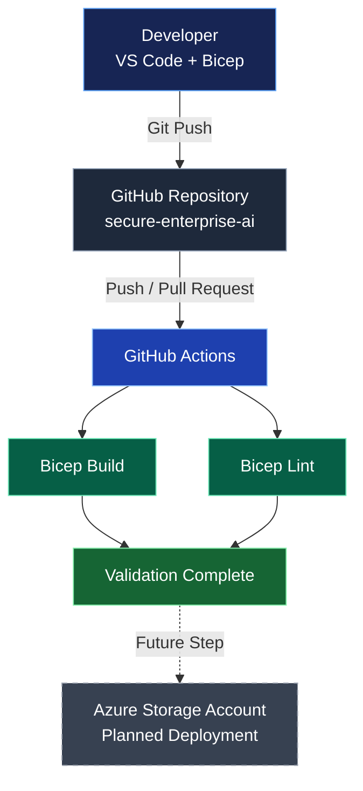

# Secure Enterprise AI – Architecture

## Current Architecture

This diagram illustrates the current Infrastructure as Code (IaC) development and validation workflow.

## Security Configuration

The current Bicep template defines an Azure Storage Account with:

- HTTPS-only traffic
- Minimum TLS version 1.2
- Anonymous blob access disabled
- Shared Key authorization disabled
- Public network access disabled

These settings provide a security-focused starting point, but additional controls are required before production deployment.

## Current Status

**Implemented:**
- Azure Storage Account Bicep template
- GitHub Actions build validation
- GitHub Actions lint validation

**Planned:**
- Azure deployment
- Private networking
- Managed identities and RBAC
- Monitoring and diagnostics
- Microsoft Foundry and AI agent integration

> A successful Bicep build and lint run does not guarantee successful Azure deployment or production security.